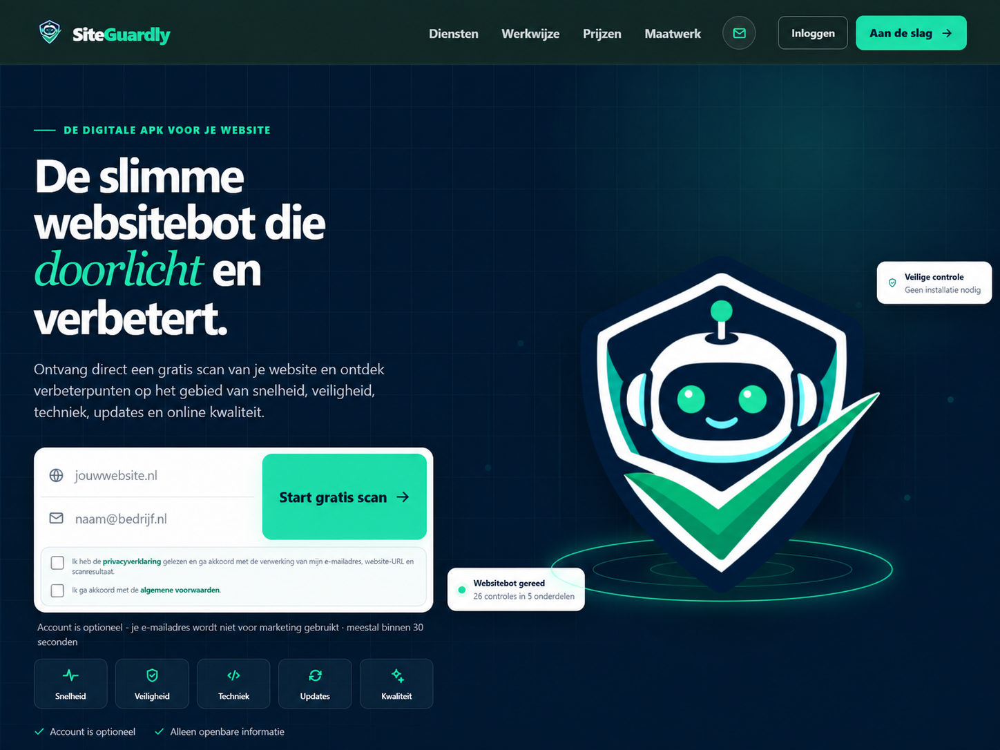
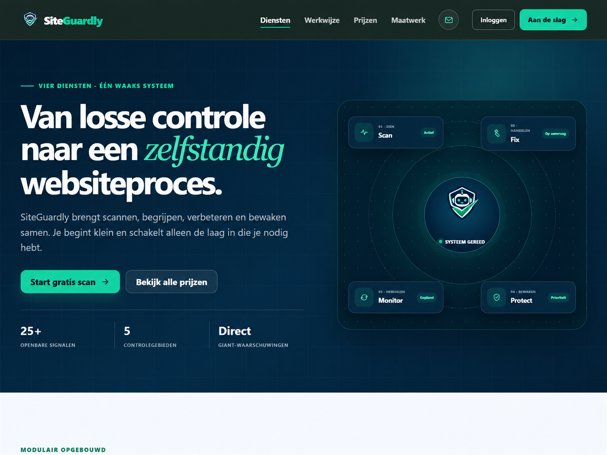
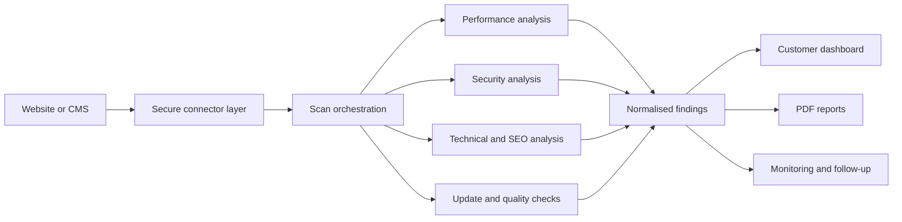
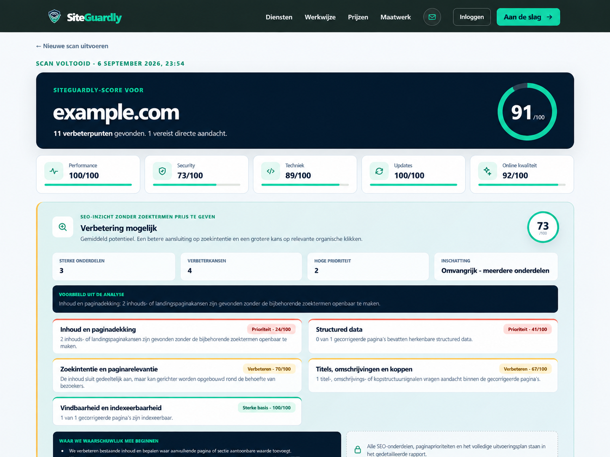

# SiteGuardly Platform

An engineering case study of a custom WordPress-based website quality, security and SEO platform developed by SiteGuardly in the Netherlands.

> This repository documents the architecture and engineering work. The production source code, security rules and customer data remain private.

## What was built

SiteGuardly combines a custom WordPress platform plugin with a purpose-built responsive theme. The platform turns public website signals and authorised CMS data into structured findings, priorities, reports and ongoing monitoring.

The work includes:

- Modular website scans covering performance, security, technical quality, updates and SEO
- A normalised findings model used by dashboards, archives and PDF reports
- Customer accounts, website management and subscription workflows
- Scheduled monitoring, retention policies and operational health checks
- Custom WordPress administration screens and customer-facing dashboards
- Integrations for WordPress and other CMS and commerce platforms
- OAuth and connector workflows for authorised data access
- Responsive reporting for desktop, tablet and mobile
- Dutch and English customer journeys
- A controlled sandbox workflow for testing changes before production deployment

## Architecture

The platform keeps data collection, analysis and presentation separate. That allows a new connector or analysis module to be added without rebuilding the reporting and customer layers.

## Engineering highlights

- Custom PHP and WordPress development rather than a stack of unrelated commercial plugins
- Separate modules for accounts, scans, reporting, monitoring, payments, SEO and integrations
- Capability checks, nonce validation, sanitisation and escaped output around WordPress actions
- Background and scheduled work designed outside normal page requests
- Connector adapters that isolate third-party APIs from the core reporting model
- Reproducible releases using dependency lock files and staged deployment packages
- A substantial automated regression suite, supplemented with responsive and browser-level checks
- Sandbox-first delivery with review and approval before live deployment

More detail is available in [Architecture](docs/architecture.md) and [Engineering practices](docs/engineering-practices.md).

## Example result

The example uses demonstration data. No customer information or production credentials are included.

## Technology

PHP, WordPress, JavaScript, HTML, CSS, REST APIs, OAuth, webhooks, scheduled processing, Composer, npm, Playwright, PDF generation and third-party platform integrations.

## Role

SiteGuardly designed and developed the product architecture, WordPress plugin, custom theme, connectors, scan and reporting workflows, responsive interfaces, test coverage and controlled release process.

## Availability

This case study demonstrates experience relevant to custom WordPress platforms, plugin development, API integrations, website security, technical SEO, reporting dashboards and long-term product development.

## Evidence and maintenance

The public documentation is checked automatically for missing local references and accidental secret-like assignments. Material portfolio updates are recorded in the [changelog](CHANGELOG.md) and versioned with GitHub releases.

## Related work

- [ETF AI Bot case study](https://github.com/SiteGuardly/etf-ai-bot-case-study)
- [Smart Home Operations Dashboard](https://github.com/SiteGuardly/smart-home-dashboard-case-study)
- [Public WordPress workflow adapter demo](https://github.com/SiteGuardly/wordpress-workflow-adapter-demo)

